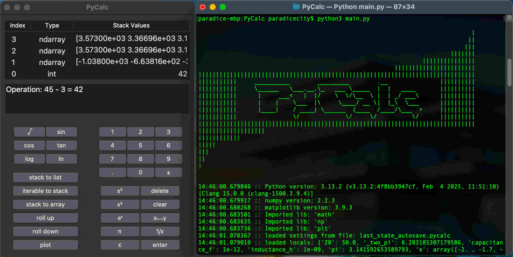
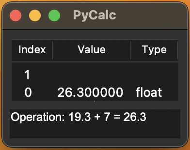
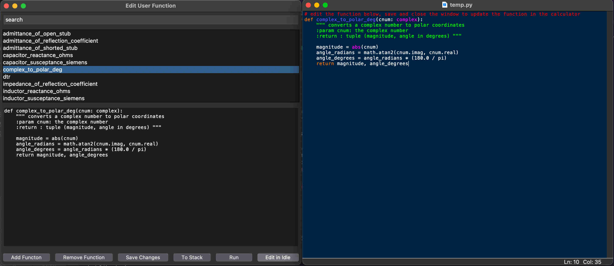
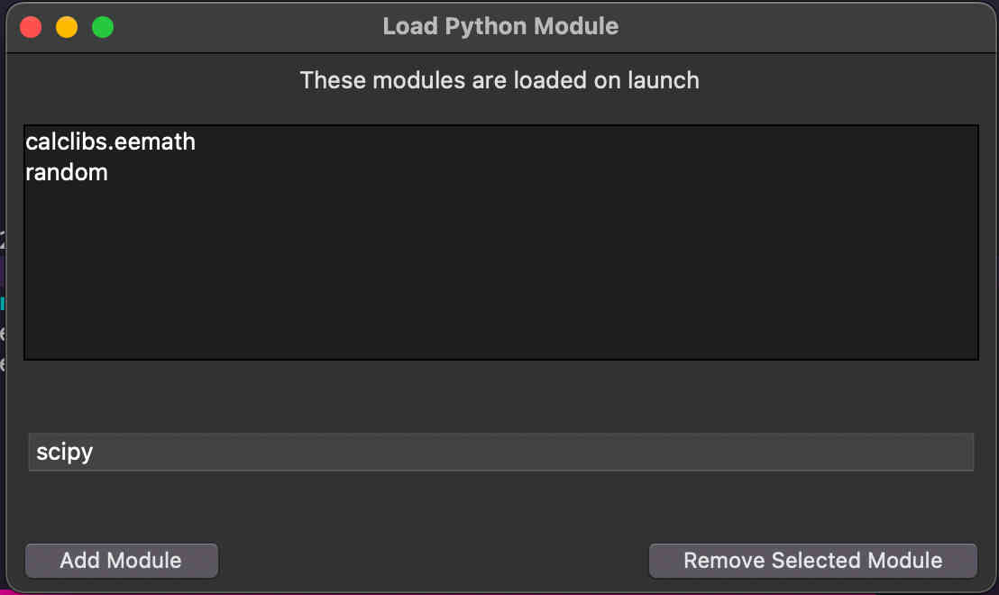
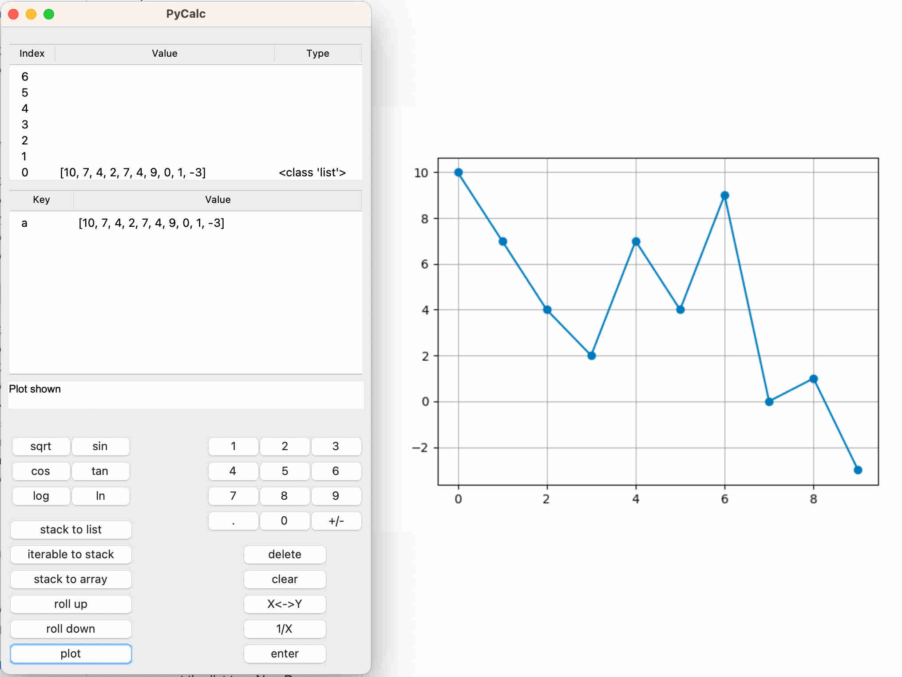
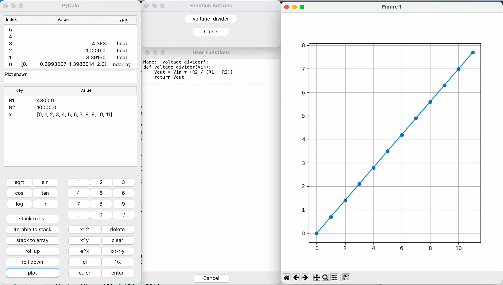
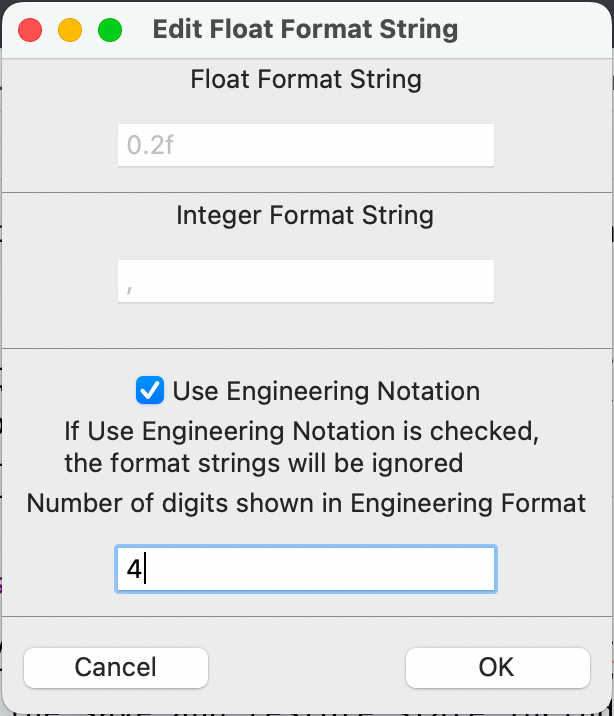

## Hello and welcome to PyCalc, the RPN ~~calculator~~ ~~IDE~~ program that loves Python





_______________________

This is the best calculator you will ever use because it packs the Python ecosystem into a fast and
familiar user interface. This project is an experiment to see what happens when you wrap a Python
interpreter in an RPN calculator interface. The result is a fast way to interact with Python through
familiar calculator controls.

I spent years using the Python terminal, Spyder, and now Jupyter notebooks. While each has its strengths,
none offers the simplicity or immediacy of a good old-fashioned calculator when working through math
problems. But a traditional calculator lacks the history and explanations of a Jupyter notebook and the
power and vast catalog of tools available in Python. Why not combine their strengths in one app?

So this project was born and has become a go-to tool for daily engineering math and quick Python scripting.



## Highlights

#### General

- [x] Feature-rich RPN calculator with user functions, variables, plotting, and history.

- [x] Novel RPN-style interface for interacting with a live Python interpreter

- [x] Built-in support for the math, NumPy, and Matplotlib libraries

- [x] Import Python modules and use their functions in the calculator

#### User Interface

- [x] Customizable Tkinter/ttk interface with stack, variable, and user function views

- [x] Support for copying and pasting between Excel and the calculator

- [x] Session history with undo and redo

- [x] Store variables of any type, including numbers, arrays, functions, class instances, and more

- [x] Save and restore sessions and state; restore the last state on launch by default

- [x] Dark and light themes that follow the system theme

What makes this program different from other calculators and IDEs is its ability to interact with Python
objects in an RPN-style stack. For example, as shown in the first picture, if you have a NumPy array at
stack position 0 and an integer at stack position 1, pressing `*` multiplies the array by the integer
and puts the result at stack position 0.

## New Features

### October 2026

#### App Builder and Icons

The new [app builder](pyinstaller_script.py) packages PyCalc as a desktop application with its own icon.
On macOS, it creates `PyCalc.app`, which can be opened from Finder without launching Python manually.
A **Launching PyCalc…** popup provides feedback while the calculator starts, and Matplotlib loads only
when plotting is needed. The builder clears previous build outputs automatically to avoid stale copies.
See [Building the desktop app](#building-the-desktop-app) below for instructions.

### April 2026

#### Improved User Functions



Navigate to **Functions -> Edit User Functions** to see all user functions in memory, edit them in a text
editor, and save changes. Buttons let you load a function onto the stack or run it directly from the
popup. You can also edit user functions in the IDLE editor.

**Search:** Use this field to find text in the user function names.

**Save Changes:** Saves the changes currently shown in the text editor.

**To Stack:** Puts the function onto the stack so that you can enter arguments by typing them in.

**Run:** Runs the function directly using the current stack values and saved variables.

### October 2025

#### User Libraries

You can now load any library on launch.



Navigate to **File -> Load Python Module** and enter the name of an installed Python module or a local module, as shown above.
Any module on the list will be loaded the next time the calculator launches.
You can also use this window to load modules while the calculator is running.
The list of modules to load is saved with the calculator state.

### How to install and launch the calculator

You can run PyCalc from source using Python and your terminal or IDE, or build a desktop application
using the instructions below. Python is required to run from source and to build the app; the packaged
app includes its Python runtime.

#### Using the UI

1. Download the repository.

2. In Terminal on macOS or Linux, or PowerShell on Windows, navigate to the directory containing `main.py`.

3. Run `python main.py` using a Python environment with NumPy, Matplotlib, and Tkinter available.

4. The calculator UI will open. See [Prepare the environment](#prepare-the-environment) for setup instructions.

### How to use the calculator

The UI behaves like an RPN calculator. If you prefer infix notation, as used on a regular calculator,
wrap your expression in parentheses, for example: `(sin(40.2 + pi) + 1.42/24)`. Press **Enter** to
evaluate the expression and display the result in the stack view and message window.

#### Quick notes on usage

1. You don't need buttons to use math functions. For example, to calculate nCr(5, 3), type **5**, **Enter**,
   **3**, **Enter**, **ncr**, **Enter**. The result appears on the stack. You can also type `ncr(5, 3)` and
   press **Enter**. See the [Python math library reference](https://docs.python.org/3/library/math.html)
   for available functions.

2. PyCalc follows calculator notation: `ln` is the natural logarithm and `log` is base 10. The calculator's
   `log` wrapper accepts one argument, so `log(3, 10)` raises an error. Use `math.log(3, 10)` to specify
   a base explicitly.

__________________________________

### Examples (using the UI)

#### Basic Math

1. Press: **1**

2. Press **Enter** in the UI or on the keyboard.

3. Press: **2**

4. Press: **+**

5. The result, `3`, appears in stack position X.

#### Using Math Functions

1. Press: **2**

2. Press: **enter**

3. Press **log**, or type `log` and press **Enter**.

4. The result of `log(2)`, approximately `0.30103`, appears in stack position X.

#### Using Variables

1. Press: **2**

2. Press: **enter**

3. Type: *my_var=*

4. Press: **enter**

5. The value `2` is stored as `my_var` and appears in the variable view.

#### Infix Calculations

1. Enter `(1+1)`. The parentheses identify it as a math expression.

2. Press **Enter** to evaluate the expression and display `2` in the stack view.


Any expression can use saved variables. For example, with a value assigned to `y`, try
`(sin(pi)/cos(y) + log(5.3*7))`.

#### Making lists and arrays

You can create Python objects directly on the stack and pass them to NumPy functions:

1. Enter `[sin(x/3) for x in range(200)]` and press **Enter** to create a list of 200 values.

2. Enter `np.array` and press **Enter** to convert the list to a NumPy array.

3. Enter `np.tan` and press **Enter** to apply the tangent function to the array.

4. Enter `a=` and press **Enter** to store the result in the variable `a`.

5. Enter `np.mean(a)` and press **Enter** to calculate its mean.

You can also copy values from Excel or Google Sheets and paste them directly into the calculator.
The calculator converts the pasted selection to a list on the stack.

#### Basic Plotting

The calculator uses Matplotlib to plot data.

1. Enter: *[10, 7, 4, 2, 7, 4, 9, 0, 1, -3]*

2. Press: **enter** -- this will evaluate the value on the stack to a list

3. Press: **plot** -- this will plot the list using Matplotlib and display the plot in a new window

You can copy rows and columns from Excel or Google Sheets and paste them directly into the calculator.



#### Even Better Plotting

You can define custom Y, XY, and XYZ plots from the plot menu. Lists and arrays stored as variables
appear in the plot dialogs' dropdown menus, with their lengths shown in parentheses. Select X and Y
variables of the same length to plot Y against X. Use **Add Plot** to add traces to the same graph.
Give each trace a unique name; reusing a name overwrites the existing trace.


#### Advanced Plotting

You can also call Matplotlib directly:

1. Enter `np.linspace(0, 10, 100)` and press **Enter** to create 100 evenly spaced points from 0 to 10.

2. Enter `x=` and press **Enter** to store the array as `x`.

3. Enter `np.sin(x/7)` and press **Enter**.

4. Enter `a=` and press **Enter** to store the sine values as `a`.

5. Enter `np.cos(x/5)` and press **Enter**.

6. Enter `b=` and press **Enter** to store the cosine values as `b`.

7. Enter `plt.plot(a, b, "r-")` and press **Enter** to plot `b` against `a` with a red line.

8. Enter `plt.show()` and press **Enter** to display the plot.

#### Using Python Libraries

On launch, the calculator imports:

```python
import math as math
import numpy as np
```

Matplotlib's `pyplot` interface is available as `plt` and loads when you first use it. You can call
library functions by typing expressions such as `np.sin([1, 2, 3, 4, 5])` and pressing **Enter**.

To use another installed library, import it from the stack:

1. Enter `import random` and press **Enter**.

2. Enter `random.randint(1, 100)` and press **Enter** to generate a random integer.

For a function that takes one argument, you can enter the function name alone to apply it to the value
on the stack:

1. Enter `[1, 2, 3, 4, 5]` and press **Enter**.

2. Enter `sum` and press **Enter** to calculate the sum of the list.

For functions that take multiple arguments, include the arguments in the expression, as in
`random.randint(1, 100)`.

### Working with User Functions

You can define your own functions and save them with the calculator session.

#### To add a user function:

1. Navigate to **Functions -> Add User Functions**.

2. In the dialog that appears, enter the function using standard Python syntax and indentation. For example:
    ```python
    def sqr_x(x):
        return x**2
    ```

3. Press **OK** to add the function to the calculator.

User functions can use variables saved in the calculator. For example, this function calculates the
output voltage of a resistor divider:

```python
def voltage_divider(Vin):
    Vout = Vin * (R2 / (R1 + R2))
    return Vout
```

Here, `R1` and `R2` are variables saved in the calculator. A function with one argument, `Vin` in this
case, is convenient for applying the function to a number or array on the stack. Other values can be
defined inside the function or saved as calculator variables.

To reproduce the example below, define `voltage_divider` and save values for `R1` and `R2`. Enter
`np.arange(0, 12)` and press **Enter**, then enter `x=` and press **Enter** to save the array as `x`.
With the array in stack position X, open **Options -> Function Buttons** and click **voltage_divider**.
The function puts the calculated output voltages on the stack. Press **Plot** to display them.

You can also enter `voltage_divider(x)` directly and press **Enter**.



#### To see all user functions:

1. Navigate to **View -> Show User Functions**.

#### To remove a user function:

1. Navigate to **Options -> Remove Function**.

2. Select a function from the list and press **Remove**.

___________________

### More User Function Controls

Use **Functions -> Edit User Functions** to view and edit functions in memory. Select a function to
load it into the text editor. Click **Save Changes** to save your edits or **Cancel** to revert them.
The **To Stack** and **Run** buttons provide two ways to use a function:

- **To Stack** loads the function into stack position X so you can type arguments and press **Enter**.
- **Run** evaluates the selected function using values from stack positions X, Y, Z, and so on, plus
  saved variables as needed.

___________________

### User Options

Use the **Options** menu to change calculator settings:

- **Save State on Exit** saves the current session when you quit. Turn it off to start with a fresh session.
- **Edit plot format string** sets the plot format. See the **fmt** parameter in the
  [Matplotlib plot reference](https://matplotlib.org/stable/api/_as_gen/matplotlib.pyplot.plot.html).
- **Edit numeric display format** sets the format for integers and floating-point numbers. See this
  [formatting cheat sheet](https://fstring.help/cheat/). Select **Use Engineering Notation** to display
  floats with exponents that are multiples of 3. **Number of digits shown** controls the displayed precision.



___________________

### View Options

Use the **View** menu to control the visibility and appearance of the calculator views:

- **Show Message Field** -- toggles the message field visibility
- **Show Variable Viewer** -- toggles the variable viewer visibility
- **Show User Functions** -- toggles the user functions window visibility
- **Standard View** -- shows all buttons, the message field, the variable viewer and the stack.
- **Mini View** -- shows only the stack view and sets the number of stack rows to 2.
- **Set Number of Stack Rows** -- opens a dialog to set the number of stack, variable and message rows to show in the UI.
- **Set Font parameters** -- opens a dialog to set the font family and size for the stack, variable viewer and message field.
- **Edit numeric display format** -- opens a dialog to set the numeric display format (see above section on User Options)


Mini View is shown above with the message field and stack view.

___________________

### Saving and Restoring Sessions

By default, the calculator saves its state on exit and restores it on launch. The state is saved as
`last_state_autosave.pycalc` in the working directory. It includes the stack, history, variables, and
calculator settings.

To save a session:

1. With values on the stack or in variables, press **Ctrl+S** or select **File -> Save**.

2. Choose a location and filename, then press **Save**.

To restore a session:

1. Press **Ctrl+O** or select **File -> Open**.

2. Select the session file and press **Open**.

__________________

#### Using the API / CLI

To use the calculator without the UI, import `calc.py` and create a `Calculator` instance:

```python
import calc

c = calc.Calculator()
ue = c.user_entry
ue('sin(43.7) + 17.3')
ue('enter')
# Evaluated: sin(43.7) + 17.3 to 17.0214373937804

c.return_stack_for_display()
# [17.0214373937804]
```

The calculator is designed to support a UI but also works from the command line. It accepts input one
character at a time, so you can also enter `sin(3)` like this:

```python
ue('s')
ue('i')
ue('n')
ue('(')
ue('3')
ue(')')
c.enter_press()
# Evaluated: sin(3) to 0.1411200080598672
```

This lets another user interface send keyboard events directly to the calculator. If you already have
a calculator UI, you can use PyCalc as its backend. I'm looking at you, Flutter and JavaScript developers!

________________________


### Building the desktop app

The builder uses PyInstaller and has been tested on macOS with Python 3.13. Build on the operating
system you intend to run the app on; a macOS build does not produce a Windows executable.

#### Prepare the environment

Open a terminal in the repository directory. On macOS, create and activate a virtual environment:

```bash
python3 -m venv .venv
source .venv/bin/activate
python -m pip install numpy matplotlib pyinstaller pillow pystray
```

Use a Python installation with Tkinter support. You can check it with `python -m tkinter`, which should
open a small test window. In PyCharm, select the same environment as the project interpreter before
running the builder.

On Windows PowerShell, create the environment with `python -m venv .venv`, activate it with
`.\.venv\Scripts\Activate.ps1`, and install the same packages.

#### Build and launch

Quit any running copy of PyCalc, then run:

```bash
python pyinstaller_script.py
```

Alternatively, right-click `pyinstaller_script.py` in PyCharm and select **Run 'pyinstaller_script'**.
Wait for the build to finish successfully before opening the app.

On macOS, double-click `dist/PyCalc.app` in Finder or run this from the repository directory:

```bash
open dist/PyCalc.app
```

You can copy `PyCalc.app` to Applications. If you keep a copy there, replace it after rebuilding;
the builder only updates the copy in this repository. On Windows, launch `dist/PyCalc/PyCalc.exe`
and keep the entire `dist/PyCalc` directory together with its dependencies.

The builder uses `--onedir` to avoid extracting dependencies at every launch. Before each build, it
removes generated `PyCalc` and former `main` outputs from `build/` and `dist/`, plus their generated
`.spec` files. After a successful build, it removes intermediate files and, on macOS, the duplicate
`dist/PyCalc` directory, leaving `dist/PyCalc.app` and the generated `PyCalc.spec`.

#### App icons

The window icon and macOS app icon come from `media/pycalc_icon_a.png`. The Windows executable icon
comes from `media/pycalc_icon_a.ico`. To change the icons, replace these images and rebuild.
The PNG is bundled automatically so the window icon also works in the packaged app.

----------------------------------------

### If you made it this far

One of the goals I had for this project was to explore the use of Tkinter. I have used various
other software packages to create UIs, and I wanted to give Tkinter a turn. So far, Tkinter has been fast and easy
to work with.

It has taken me about twice as long to write this README as it took to write the code itself, but the
process has been useful because I found a few bugs along the way.
